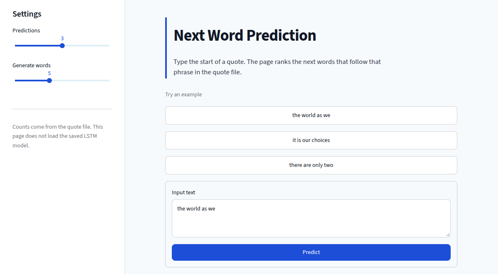

<div align="center">

# Next Word Prediction

Type the start of a quote. The page ranks the next words that follow it.

[](https://opensource.org/licenses/MIT)
[](https://www.python.org/downloads/)


[Open the app](https://nextwordprediction-gj6q3h2okjbqevqbmzuw43.streamlit.app/)

</div>

The page in this repository:

<p align="center">
  
</p>

Pick an example or type your own sentence, then press Predict. The result is a ranked next word, its share of the matching quote context, and a short continuation. Enter submits the form.

## Run it locally

```bash
python3 -m venv .venv
source .venv/bin/activate
python -m pip install streamlit
streamlit run app.py
```

The page reads `qoute_dataset.csv` from the project root. That filename spelling is the one the app and the notebook both open.

There is no `requirements.txt` on purpose. Streamlit Community Cloud already provides Streamlit, and a requirements file that pulls in TensorFlow breaks that deploy. `tests/test_deployment_config.py` fails if `requirements.txt` or `runtime.txt` is added.

## What the page predicts

`app.py` builds one `DatasetPredictor` from the `quote` column. For each word, the predictor counts what follows the previous 1 to 5 words. A query uses the longest of those contexts that exists, then returns the most common next words. The percentage is that word's count divided by the counts in the same context.

The saved LSTM files are not loaded by the page.

| Input | Next word |
| --- | --- |
| `the world as we` | `have` |
| `it is our choices` | `harry` |
| `there are only two` | `ways` |

An empty box asks you to enter some text. A phrase with no recorded next word says so, instead of inventing one.

## Repository

```text
app.py                    Streamlit page
next_word_predictor.py    Quote n-gram predictor, plus LSTM helpers the page does not call
qoute_dataset.csv         quote, Author
RNN_2_proj.ipynb          Colab notebook that trains the LSTM
lstm_model.h5             Saved Keras model
tokenizer.pkl             Saved tokenizer
max_len.pkl               Saved sequence length
assets/demo.png           Screenshot of the current page
tests/                    Predictor tests and the Streamlit page flow
AGENTS.md                 Map of what to leave alone
```

The CSV holds 3,038 quotes. The page uses the quote text only.

## Notebook

`RNN_2_proj.ipynb` loads the same CSV and trains an LSTM. Running it needs TensorFlow, NumPy, pandas, Matplotlib, and Seaborn. Those packages are for the notebook, not for the deployed page. `load_artifacts()` in `next_word_predictor.py` opens the three saved files and imports TensorFlow only when called.

## Tests

```bash
python -m unittest discover -s tests -t .
```

`tests/test_app.py` checks the page and skips when Streamlit is not installed, so the command still passes in a bare Python environment.

## Author

- GitHub: [sumitjadhav1703](https://github.com/sumitjadhav1703)
- LinkedIn: [sumit-jadhav-1703s](https://www.linkedin.com/in/sumit-jadhav-1703s/)
- App: [nextwordprediction](https://nextwordprediction-gj6q3h2okjbqevqbmzuw43.streamlit.app/)
- Email: jadhavsumit534@gmail.com

## License

MIT. See [LICENSE](LICENSE).
