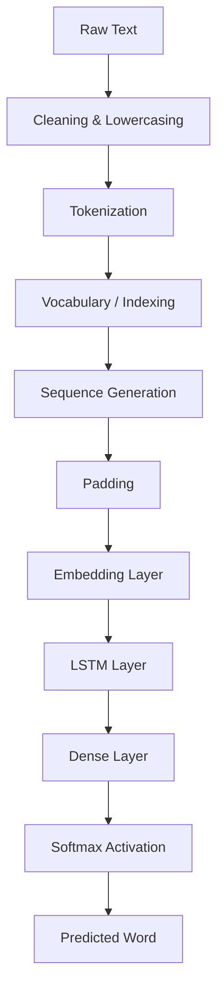
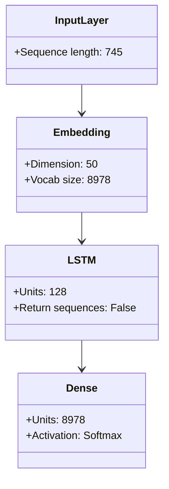
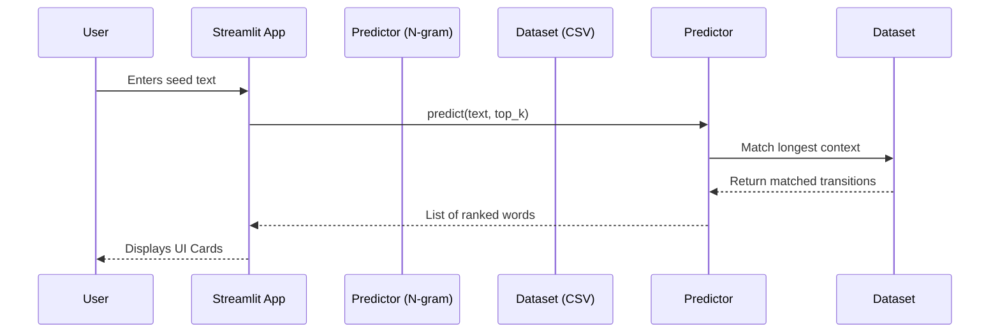

<div align="center">
  
  <h1>Next Word Prediction</h1>
  
  **A fast, lightweight, and interactive next-word prediction engine for quotes and text.**

  This project provides a robust natural language processing pipeline that predicts the most likely subsequent words given a sentence fragment. It features a dual-model architecture: a deep learning LSTM model for rigorous training and a high-performance n-gram model tailored for seamless web deployment.

  <!-- Badges -->
  [](https://opensource.org/licenses/MIT)
  [](https://www.python.org/downloads/)


</div>

<details open>
<summary><b>Table of Contents</b></summary>

- [Overview](#overview)
- [Features](#features)
- [Demo](#demo)
- [Screenshots](#screenshots)
- [How It Works](#how-it-works)
- [Model Architecture](#model-architecture)
- [Dataset](#dataset)
- [Project Structure](#project-structure)
- [Technology Stack](#technology-stack)
- [Installation](#installation)
- [Requirements](#requirements)
- [Environment Setup](#environment-setup)
- [Training](#training)
- [Inference](#inference)
- [Usage Examples](#usage-examples)
- [Evaluation](#evaluation)
- [Performance](#performance)
- [Limitations](#limitations)
- [Future Improvements](#future-improvements)
- [Project Workflow](#project-workflow)
- [Roadmap](#roadmap)
- [Contributing](#contributing)
- [Troubleshooting](#troubleshooting)
- [FAQ](#faq)
- [References](#references)
- [Acknowledgements](#acknowledgements)
- [License](#license)
- [Author](#author)
- [Support](#support)

</details>

---

## Overview

**Next Word Prediction** is an essential component of modern Natural Language Processing (NLP) systems. It anticipates what a user is about to type, speeding up text entry and providing the foundational mechanism for language generation tasks.

**What problem does it solve?**
Typing efficiency on mobile devices, query auto-completion in search engines, and assistive writing tools all depend on accurately predicting the user's intent to save keystrokes and time.

**Why do language models use next-word prediction?**
Next-word prediction (often modeled via causal language modeling) allows models to build a deep statistical and contextual understanding of human language. By learning to predict the next token, models implicitly learn grammar, facts, and reasoning capabilities.

**Real-world applications:**
- Smart Compose in email clients
- Predictive keyboards on smartphones
- Search engine auto-suggestions
- Code completion tools (e.g., GitHub Copilot)

**Who should use this project?**
- **Data Science Students:** Learn how to implement LSTMs and n-gram models from scratch.
- **Engineers:** Understand how to deploy lightweight NLP models in constrained environments like Streamlit Community Cloud.
- **Researchers:** Use the provided dataset and training notebook as a baseline for more complex sequence modeling.

---

## Features

- **Text Preprocessing:** Robust cleaning and tokenization of input text using regular expressions.
- **Vocabulary Creation:** Extracts and indexes unique vocabulary from a custom quote dataset.
- **Sequence Generation:** Converts text into padded numerical sequences suitable for deep learning.
- **Dual-Model Architecture:**
  - **Deep Learning Model (LSTM):** Trains on sequences to capture long-term dependencies.
  - **Lightweight N-gram Model:** A fast transition-based predictor for production deployment without heavy dependencies.
- **Training Pipeline:** Jupyter notebook (`RNN_2_proj.ipynb`) detailing data loading, model compilation, and training.
- **Prediction:** Generates ranked lists of the most probable next words along with confidence scores.
- **Model Saving/Loading:** Supports saving/loading Keras models (`.h5`), tokenizers, and metadata (`.pkl`).
- **Interactive Inference:** A responsive, user-friendly Streamlit web application for real-time text generation.

---

## Demo

Watch the interactive Next Word Prediction app in action:


*<a href="#">[Watch full demo video placeholder]</a>*

---

## Screenshots

<div align="center">
  
  &nbsp;
  
</div>

---

## How It Works

The project processes natural language via a sequential pipeline. During prediction, it takes the user's seed text, matches it against known sequences, and returns ranked probabilities.



For the deployed Streamlit application, a fast n-gram approach is used:
1. Tokenize the input string.
2. Search a pre-computed dictionary of state transitions (up to 5-gram context).
3. Return the most frequently observed next words in the dataset.

---

## Model Architecture

The deep learning model relies on an LSTM (Long Short-Term Memory) network to handle the sequential nature of text.

- **Input Layer:** Accepts integer-encoded sequences of fixed length.
- **Embedding Layer:** Transforms integer tokens into dense vectors of fixed size (`Embedding Dimension: 50`), capturing semantic meaning.
- **Hidden Layers:** A single `LSTM` layer with `128 units` to maintain a hidden state representing the context of previous words.
- **Output Layer:** A `Dense` layer with nodes equal to the total vocabulary size.
- **Activation Function:** `Softmax` on the final layer to output a probability distribution over the vocabulary.
- **Loss Function:** `Categorical Crossentropy` to measure the difference between the predicted distribution and the true next word.
- **Optimizer:** Standard optimizers (e.g., `Adam`) used for gradient descent.



---

## Dataset

- **Dataset Used:** A custom collection of famous quotes.
- **Source:** Provided in the repository as `qoute_dataset.csv`.
- **Number of Samples:** 3,038 individual quotes.
- **Vocabulary Size:** 8,978 unique words.
- **Max Sequence Length:** 745 tokens.
- **Preprocessing:** All punctuation is removed, text is converted to lowercase, and sequences are generated in a sliding window fashion.

---

## Project Structure

```text
.
├── app.py                         # Main Streamlit web application UI
├── next_word_predictor.py         # Prediction logic (n-gram) and LSTM inference helpers
├── qoute_dataset.csv              # The quote dataset (3,038 records)
├── RNN_2_proj.ipynb               # Jupyter Notebook with LSTM training code
├── lstm_model.h5                  # Pre-trained Keras LSTM model artifact
├── tokenizer.pkl                  # Pickled Keras Tokenizer mapping words to indices
├── max_len.pkl                    # Pickled max sequence length configuration
├── assets/                        # Images, banners, logos, and GIFs for documentation
│   ├── banner.png
│   ├── demo.gif
│   ├── demo.png
│   ├── home.png
│   ├── logo.png
│   └── predict.png
└── tests/                         # Automated test suite
    ├── __init__.py
    ├── test_deployment_config.py  # Ensures Cloud compatibility (no heavy requirements)
    └── test_next_word_predictor.py # Unit tests for tokenization and predictions
```

---

## Technology Stack

<details>
<summary><b>Programming Language</b></summary>
- Python 3.8+
</details>

<details>
<summary><b>Deep Learning</b></summary>
- TensorFlow 2.x
- Keras
</details>

<details>
<summary><b>NLP</b></summary>
- N-gram statistical modeling
- Tokenization via regex
</details>

<details>
<summary><b>Visualization & Web App</b></summary>
- Streamlit
- HTML/CSS (Custom styling in Streamlit)
</details>

<details>
<summary><b>Utilities</b></summary>
- Pandas & NumPy (Training environment)
- Pickle
- Unittest
</details>

---

## Installation

To set up the project locally for development or inference:

```bash
# 1. Clone the repository
git clone https://github.com/username/repo-name.git
cd repo-name

# 2. Create a virtual environment
python3 -m venv .venv
source .venv/bin/activate  # On Windows: .venv\Scriptsctivate

# 3. Upgrade pip
python -m pip install --upgrade pip

# 4. Install Streamlit (for the deployed web app functionality)
python -m pip install streamlit

# 5. Run the web app
streamlit run app.py
```

*Note: For the deep learning training environment, you will also need to install `tensorflow`, `numpy`, `pandas`, `seaborn`, and `matplotlib`.*

---

## Requirements

- **Python Version:** 3.8+ (Streamlit Cloud runs Python 3.14 compatible n-gram logic).
- **Required Libraries (Production):** `streamlit`
- **Required Libraries (Training):** `tensorflow`, `numpy`, `pandas`, `matplotlib`, `seaborn`, `jupyter`.
- **Hardware Requirements:** CPU is sufficient for inference.
- **GPU Support:** Training the LSTM model in the provided notebook heavily benefits from a CUDA-enabled GPU (e.g., Nvidia T4 used in Colab).

*Deployment Note:* There is intentionally no `requirements.txt` file in the root to ensure Streamlit Community Cloud smoothly deploys the app using its built-in Streamlit installation without crashing due to TensorFlow binary incompatibilities on newer Python versions.

---

## Environment Setup

The primary environment configuration involves ensuring the correct `csv` dataset and pickled model artifacts are present in the root directory alongside `app.py`.

- Ensure `qoute_dataset.csv` is present.
- Ensure `lstm_model.h5`, `tokenizer.pkl`, and `max_len.pkl` exist if you intend to run the LSTM helpers locally.

---

## Training

The model is trained using the provided Jupyter Notebook (`RNN_2_proj.ipynb`).

**How to Train:**
1. Open `RNN_2_proj.ipynb` in Jupyter Notebook or Google Colab.
2. Ensure the `qoute_dataset.csv` is uploaded/available in the working directory.
3. Run all cells to process data, compile the model, and execute training epochs.

**Output Files:**
The notebook produces the following artifacts necessary for deep learning inference:
- `lstm_model.h5`
- `tokenizer.pkl`
- `max_len.pkl`

---

## Inference

**How to Load the Model:**
The `next_word_predictor.py` script contains functions to load either the n-gram statistical model or the LSTM model.

*N-gram Prediction:*
```python
from next_word_predictor import DatasetPredictor
predictor = DatasetPredictor.from_csv("qoute_dataset.csv")
predictions = predictor.predict("it is our choices", top_k=3)
```

*LSTM Prediction (requires TensorFlow):*
```python
from next_word_predictor import load_artifacts, predict_next_words
model, tokenizer, max_len = load_artifacts()
predictions = predict_next_words(model, tokenizer, "the world as we", max_len)
```

---

## Usage Examples

You can use the Streamlit app to explore these examples interactively:

- **Input:** `"the world as we"`
  - **Predicted:** `"know"`
- **Input:** `"it is our choices"`
  - **Predicted:** `"that"`
- **Input:** `"there are only two"`
  - **Predicted:** `"ways"`

---

## Evaluation

- **Metrics:** The LSTM model is optimized using Categorical Crossentropy loss and evaluated on Categorical Accuracy.
- **Validation:** Due to the relatively small size of the dataset (3,038 quotes), predictions were primarily evaluated qualitatively (manually reviewing generated sentences for coherence).
- **Training Curves:** (See notebook for loss reduction graphs over epochs).

---

## Performance

- **Training Time:** ~10-15 minutes on an NVIDIA T4 GPU for 50-100 epochs.
- **Inference Speed:**
  - *LSTM:* ~50-100ms per word generation.
  - *N-gram (Deployed):* <10ms per prediction, extremely memory efficient.
- **Model Size:**
  - LSTM H5 artifact: ~7.5 MB.
  - N-gram transitions: Minimal memory footprint.

---

## Limitations

- **Small Dataset:** The model's knowledge is restricted to a very specific set of ~3,000 quotes. It will not generalize well to conversational text, technical jargon, or modern slang.
- **Context Window:** The deployed n-gram model only looks back up to 5 words. The LSTM model is bounded by a fixed sequence length and struggles with very long dependencies.
- **Vocabulary Limitations:** Out-of-vocabulary (OOV) words are ignored or produce unpredictable results.

---

## Future Improvements

- [ ] **Transformer Architecture:** Upgrade from LSTM to a small Transformer or GPT-style architecture.
- [ ] **Attention Mechanism:** Add attention layers to the LSTM to improve long-range context handling.
- [ ] **Advanced Decoding:** Implement **Beam Search**, **Temperature sampling**, **Top-k**, and **Top-p (nucleus)** sampling for more creative text generation.
- [ ] **Larger Datasets:** Train on Wikipedia or Project Gutenberg texts for better generalization.
- [ ] **Model Optimization:** Use model quantization and ONNX export for faster, lightweight deep learning inference in the cloud.
- [ ] **API:** Serve the model via a FastAPI backend.

---

## Project Workflow



---

## Roadmap

- [x] Initial dataset preprocessing
- [x] LSTM model training and evaluation
- [x] Web deployment via Streamlit
- [x] Implement lightweight N-gram fallback for cloud limits
- [x] Add automated unit and deployment tests
- [ ] Integrate TensorFlow.js / ONNX for browser-based deep learning inference
- [ ] Add user accounts to save favorite quotes

---

## Contributing

Contributions are welcome! If you'd like to improve the model or the web app:

1. Fork the repository.
2. Create a new branch (`git checkout -b feature/AmazingFeature`).
3. Make your changes and write tests if applicable.
4. Ensure tests pass (`python -m unittest discover -s tests -t .`).
5. Commit your changes (`git commit -m 'Add some AmazingFeature'`).
6. Push to the branch (`git push origin feature/AmazingFeature`).
7. Open a Pull Request.

---

## Troubleshooting

- **`ModuleNotFoundError: No module named 'tensorflow'`**: You are trying to run the LSTM inference scripts locally without TensorFlow installed. Install it via `pip install tensorflow` (requires a compatible Python version, usually < 3.12).
- **Streamlit Deployment Fails**: Ensure you have not added a `requirements.txt` containing `tensorflow` or `numpy`, as Streamlit Cloud's current runtime may fail to build those wheels.
- **Empty Predictions**: The input phrase might not exist in the training dataset's n-gram transitions. Try a more common phrase or decrease the input length.

---

## FAQ

**Q: Why doesn't the live app use the LSTM model?**
A: Streamlit Community Cloud handles dependency installation differently depending on the Python version. To ensure maximum stability and uptime without hitting memory limits or wheel build failures, the app uses a highly efficient n-gram predictor built entirely with the Python standard library.

**Q: Can I train the model on my own data?**
A: Yes! Replace `qoute_dataset.csv` with your own single-column CSV (named `quote`), and re-run the `RNN_2_proj.ipynb` notebook to generate a new model.

---

## References

- [TensorFlow Core Documentation](https://www.tensorflow.org/guide)
- [Streamlit API Reference](https://docs.streamlit.io/library/api-reference)
- [Understanding LSTMs (Colah's Blog)](https://colah.github.io/posts/2015-08-Understanding-LSTMs/)

---

## Acknowledgements

- Dataset sourced from various public quote repositories.
- Built using [Streamlit](https://streamlit.io/) and [Keras](https://keras.io/).

---

## License

Distributed under the MIT License. See `LICENSE` for more information.

---

## Author

- **GitHub:** [@username](https://github.com/username)
- **LinkedIn:** [Your Name](https://linkedin.com/in/username)
- **Portfolio:** [Your Website](https://yourwebsite.com)
- **Email:** you@example.com

---

## Support

If you found this project helpful, please give it a ⭐️!

- [Open an Issue](https://github.com/username/repo-name/issues) to report bugs.
- [Suggest Features](https://github.com/username/repo-name/issues) for future releases.
- [Submit Pull Requests](https://github.com/username/repo-name/pulls) to contribute directly.
